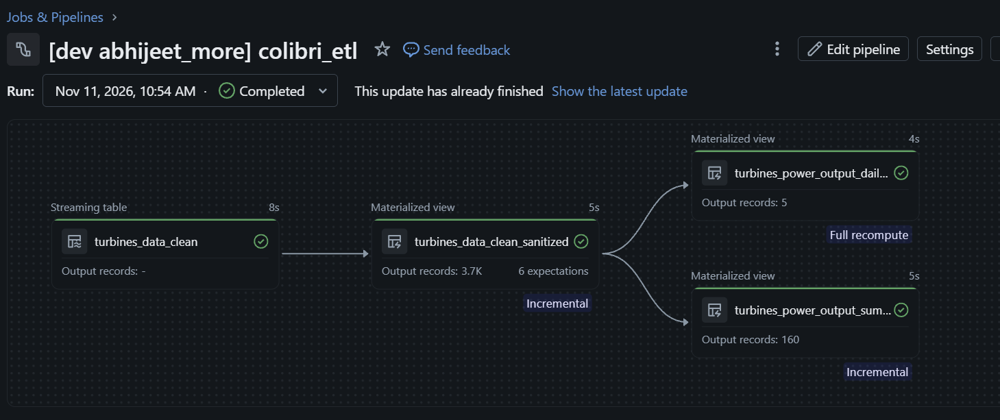

# colibri

* `src/`: Python transformations source code for this project.
  * `src/colibri_etl/`: stores ETL transformations with subfolders for each layer of medallion architecture
* `resources/`:  Resource configurations (jobs, pipelines, etc.)
* `tests/`: Unit tests for the shared Python code.
* `fixtures/`: Fixtures for data sets (primarily used for testing).

## Design decisions

The project uses the Databricks Delta Live Tables (DLT) framework, now called
Lakeflow Declarative Pipelines, for its built-in declarative pipeline features
and support for processing snapshot data with Auto CDC.

The turbine pipeline reads the latest dated snapshot and uses Auto CDC to
compare it with the previously processed snapshot. Records are identified by
`timestamp` and `turbine_id`; the pipeline applies detected inserts, updates,
and deletes to the target using SCD Type 1 semantics. Downstream datasets are
built from this CDC-managed target, so they reflect the changes between
snapshots rather than requiring each downstream transformation to compare
snapshots independently.

### Table and compute choices

The pipeline uses a materialized view for the sanitized dataset and is
configured for serverless compute. Materialized views can be incrementally
refreshed when Databricks determines that the query and source changes support
incremental processing, avoiding a full recomputation when possible. Databricks
uses its Enzyme incremental computation engine to determine and perform these
incremental refreshes when supported.

The pipeline writes tables in Unity Catalog. Using Unity Catalog managed
tables delegates table storage and lifecycle management to Databricks, with
platform-managed performance optimizations applied where supported and
configured.

### RAW layer scope

This project does not implement the RAW ingestion layer. It assumes a separate
data integration process extracts data from the source and publishes a
complete daily snapshot under a dated folder in the configured volume
location. The pipeline reads those snapshots from the volume and processes
them downstream.

### Data quality rules

The sanitized turbine dataset normalizes incoming values before validating them:
timestamps are parsed as timestamps, turbine IDs are converted to strings and
trimmed, and wind speed, wind direction, and power output are converted to
numeric values. DLT expectations drop rows that do not meet the following
checks:

* The timestamp must parse to a non-null value.
* The trimmed turbine ID must be present and non-empty.
* Wind speed, wind direction, and power output must each be present and
  castable to a number. Blank or invalid values become null and fail these
  checks.
* Wind direction must be between 0 and 359 degrees, inclusive.

These are row-level quality rules: any row failing an expectation is excluded
from the sanitized dataset. The pipeline does not currently enforce a valid
range for wind speed or power output.

### Scalability and testability

The pipeline separates snapshot ingestion, data-quality filtering, and
downstream transformations into distinct datasets. Auto CDC maintains the
current state of the keyed records, so downstream datasets can build from that
state instead of each independently comparing full snapshots. The declarative
pipeline and managed tables let Databricks manage execution and incremental
updates as data volumes grow; the pipeline is configured to use serverless
compute.

Transformation helpers are kept separate from pipeline orchestration so
folder selection, snapshot-version decisions, and value normalization can be
tested with small inputs. The tests use a CSV fixture for representative
records, including whitespace and blank numeric values. The Spark-backed
transformation test requires Databricks Connect credentials and compute access.

### Late-arriving data

Late records are picked up when they are included in a newly published,
newer-dated snapshot. Auto CDC compares that snapshot with the last processed
one using `timestamp` and `turbine_id`, so a late record with a new key can be
inserted, and a changed record with an existing key can update the current
state. Downstream datasets then reflect that updated state on pipeline
updates.

The snapshot reader deliberately processes only the latest valid dated folder
and skips folders whose version is not newer than the last processed version.
Therefore, adding or correcting data in an older folder after a newer snapshot
has been processed will not be detected automatically. To support that case,
publish the correction in a new, later snapshot (or extend the ingestion design
to discover and reprocess changed historical snapshots). This design also
assumes each dated input is a complete snapshot; if inputs are daily deltas
instead, snapshot comparison and deletion semantics need to be reconsidered.

## AI use disclosure

AI tools were used to help develop the SQL for identifying anomalies, data
quality rules, test cases, and project documentation. These outputs should be
reviewed and validated against the project requirements and data.

## Future enhancements

* Add structured application logging with Python's `logging` module to make
  snapshot discovery, pipeline processing, and failures easier to monitor and
  troubleshoot.
* Capture records that fail data quality checks in a separate quarantine table
  for investigation and possible correction, instead of dropping them.
* Move hard-coded table names into configuration or pipeline variables so
  datasets can be named and deployed more flexibly across environments.
* Evaluate liquid clustering for suitable tables to improve query performance
  as data volume and access patterns grow.

## Alternative design: Apache Spark Structured Streaming

This pipeline could instead be implemented directly with Apache Spark
Structured Streaming APIs. Lakeflow Declarative Pipelines (formerly DLT) builds
on Spark's streaming capabilities and adds declarative dataset definitions,
managed pipeline execution, and built-in data quality and incremental
processing features.

For transformations or processing routines that are difficult to express
within the pipeline framework, using Structured Streaming directly can provide
more control over the processing logic and runtime behavior. The trade-off is
greater development and operational effort: the application must explicitly
handle concerns such as checkpoints, recovery, schema changes, and monitoring
that the managed pipeline framework provides or simplifies.
